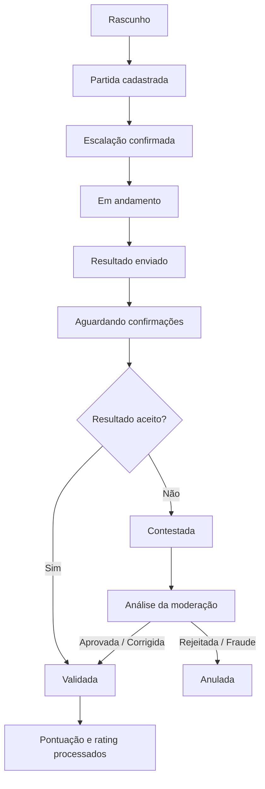
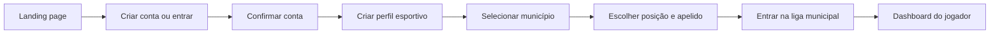
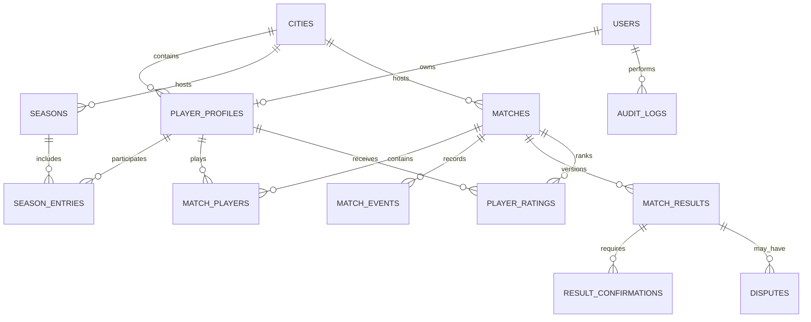
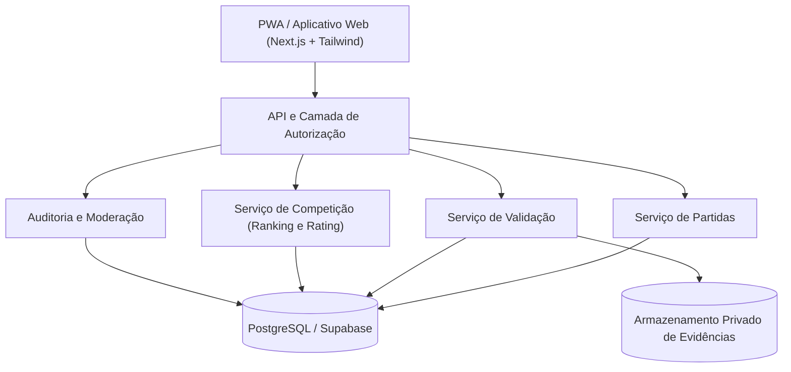

# PRD — Liga de Jogadores de Futebol Amador (Rosália Esportes)

**Documento de requisitos do produto · Versão 1.0 · Outubro de 2026**  
**Referência estética:** [Greenways FC — Luke Nicholls](https://www.lukenicholls.co.uk/greenways-fc)

| Atributo | Definição |
| :--- | :--- |
| **Produto** | Liga individual de futebol amador — **Rosália Esportes** |
| **Lançamento** | Uma cidade, com expansão progressiva |
| **Sistema competitivo** | Ranking sazonal + Rating de habilidade |
| **Modelo de acesso** | Gratuito para todos no lançamento |

---

## 1. Resumo executivo

A **Liga de Jogadores Rosália Esportes** será uma plataforma digital para organizar e reconhecer o desempenho de jogadores de futebol amador. O atleta poderá registrar sua participação em partidas comunitárias, validar seus resultados, acumular pontos competitivos e construir um histórico esportivo verificável.

O produto terá duas classificações independentes:

- **Ranking de temporada:** mede os pontos competitivos acumulados durante um período definido.
- **Rating de habilidade:** estima a força competitiva do atleta considerando resultados, adversários, posição e confiabilidade dos dados.

Essa separação é fundamental. Um jogador que participa de muitas partidas pode liderar a temporada, enquanto outro, com menos jogos e resultados consistentes contra adversários fortes, pode apresentar um rating superior.

A plataforma não exigirá que o atleta pertença a um clube formal. O foco será o futebol praticado em bairros, campos comunitários, grupos de amigos e equipes amadoras.

### Objetivos do produto
- Criar um ranking municipal confiável de jogadores amadores.
- Tornar o desempenho esportivo mensurável e compartilhável.
- Permitir que partidas comunitárias alimentem uma competição contínua.
- Reduzir fraudes por meio de confirmação e auditoria.
- Estabelecer uma arquitetura preparada para múltiplas cidades.
- Construir uma comunidade que mantenha jogadores ativos ao longo das temporadas.

### Não objetivos do MVP
- Apostas esportivas ou premiações em dinheiro.
- Mercado de transferências ou contratação profissional.
- Reconhecimento automático de jogadas por inteligência artificial.
- Transmissão ao vivo obrigatória.
- Cobrança de assinatura dos jogadores.
- Criação de uma federação oficial ou substituição das entidades esportivas existentes.

---

## 2. Regras de competição

### 2.1. Estrutura das ligas
A plataforma utilizará uma hierarquia geográfica:
1. **Município:** classificação principal de cada cidade.
2. **Região:** agrupamento de municípios participantes.
3. **Estado:** classificação estadual.
4. **Nacional:** comparação entre atletas elegíveis de diferentes estados.

As classificações regionais, estaduais e nacionais serão habilitadas somente quando houver volume suficiente de partidas verificadas e cobertura razoável entre cidades. Até lá, poderão ser exibidas como indisponíveis, sem simular uma classificação nacional completa.

### 2.2. Temporadas

| Regra | Definição inicial |
| :--- | :--- |
| **Duração** | 10 semanas |
| **Período de tolerância** | 7 dias para contestação e correções, conforme calendário publicado |
| **Entrada de novos jogadores** | Permitida durante a temporada |
| **Partidas elegíveis** | Partidas comunitárias registradas e validadas |
| **Pontuação** | Zera a cada nova temporada |
| **Rating de habilidade** | Continua entre temporadas |
| **Histórico** | Permanente, sujeito às regras de privacidade e integridade |

A duração de dez semanas é uma configuração inicial recomendada, não uma limitação técnica. Administradores poderão configurar temporadas futuras sem alterar retroativamente as regras de temporadas encerradas.

### 2.3. Divisões
A liga contará com cinco divisões: **Bronze**, **Prata**, **Ouro**, **Platina** e **Diamante**.

A divisão representa o nível competitivo estimado do atleta. O ranking da temporada, por sua vez, determina sua posição entre os participantes daquele período.

**Regras propostas:**
- Novos jogadores começam em **classificação provisória**, inicialmente associados à divisão **Bronze** para exibição, sem presumir que sejam os mais fracos.
- O sistema atribui uma classificação mais confiável conforme o atleta acumula resultados válidos.
- A promoção ou o rebaixamento ocorre no encerramento da temporada, conforme o rating, o número mínimo de partidas e os limites publicados antes do início.
- A classificação pode mudar entre temporadas, mas o histórico das divisões anteriores permanece disponível.
- O administrador não poderá alterar individualmente a divisão de um atleta sem motivo registrado e trilha de auditoria.

A distribuição exata de vagas de promoção e rebaixamento será configurável por cidade e temporada. Para evitar distorções no início, divisões com poucos jogadores podem ser exibidas como níveis, sem criar competições artificiais.

---

## 3. Sistema híbrido de classificação

### 3.1. Ranking de temporada
O ranking de temporada será calculado a partir dos pontos acumulados em partidas validadas.

**Tabela-base proposta:**

| Evento | Pontos |
| :--- | :--- |
| Participação em partida validada | `+5` |
| Vitória da equipe | `+15` adicionais |
| Empate da equipe | `+5` adicionais |
| Derrota da equipe | `+0` adicionais |
| Gol validado | `+3` |
| Assistência validada | `+2` |
| MVP validado | `+3` |

Assim, a pontuação total de uma partida será:

$$P = 5 + R + 3G + 2A + 3M$$

Em que:
- $P$ = pontos da partida.
- $R$ = bônus de resultado: `15` na vitória, `5` no empate e `0` na derrota.
- $G$ = gols individuais validados.
- $A$ = assistências validadas.
- $M$ = indicador de MVP, igual a `1` se confirmado e `0` caso contrário.

**Exemplo:** jogador participa de uma vitória, marca dois gols e dá uma assistência:

$$P = 5 + 15 + (3 \times 2) + (2 \times 1) + (3 \times 0) = 28$$

O cálculo será feito no servidor após a validação do resultado. O cliente não poderá enviar livremente uma pontuação final.

#### Regras complementares
- Apenas partidas finalizadas e validadas geram pontos.
- Uma partida não pode gerar pontos duplicados para o mesmo atleta.
- O atleta precisa constar na escalação confirmada e cumprir os requisitos mínimos de participação definidos para o formato do jogo.
- Gol, assistência e MVP precisam ser validados; não se presumem automaticamente a partir do placar.
- Partidas anuladas terão seus pontos revertidos por uma operação auditável.
- Partidas com resultado contestado não geram pontos definitivos até a resolução.
- Os **critérios de desempate** serão, nesta ordem:
  1. Maior rating de habilidade;
  2. Maior número de vitórias validadas;
  3. Maior número de partidas válidas;
  4. Maior número de MVPs validados.
- O ranking deve identificar claramente os pontos pendentes e os pontos confirmados.

### 3.2. Rating de habilidade
O rating mede a força competitiva estimada do jogador e não se confunde com os pontos da temporada.

A recomendação técnica é começar com um sistema inspirado em **Elo**, adaptado para equipes e futebol amador. O valor inicial é de **1.000 pontos**, com classificação provisória durante as primeiras partidas.

O sistema deve considerar:
- Força estimada dos adversários.
- Resultado da equipe.
- Rating anterior dos participantes.
- Quantidade e confiabilidade dos resultados.
- Posição do jogador, quando houver dados suficientes para calibrar modelos específicos.
- Incerteza estatística associada a jogadores novos ou com poucas partidas.

Uma atualização simplificada segue:

$$R_{\text{novo}} = R_{\text{anterior}} + K(S - E)$$

Em que:
- $R$ é o rating do atleta.
- $K$ é um fator de atualização configurável (maior em período provisório, menor quando consolidado).
- $S$ é o resultado observado (`1` vitória, `0.5` empate, `0` derrota).
- $E$ é o resultado esperado, calculado a partir da força relativa média das equipes participantes:

$$E = \frac{1}{1 + 10^{(\bar{R}_{\text{adversários}} - \bar{R}_{\text{equipe}}) / 400}}$$

O cálculo definitivo leva em conta o rating médio dos companheiros e adversários, o formato da partida e a incerteza dos dados. Não se deve atualizar o rating de todos os jogadores de forma isolada apenas pelo placar, ignorando a composição das equipes.

> [!IMPORTANT]
> **Regra importante:** gols e assistências **não** devem ser adicionados diretamente ao rating de habilidade na primeira versão. Isso evita privilegiar atacantes e permite comparar a força competitiva sem confundir rating com estatísticas individuais.

### 3.3. Nota de desempenho por posição
A plataforma poderá apresentar uma nota de desempenho de `0` a `100`, separada do rating, quando houver dados suficientes:
- **Atacantes:** gols, assistências e contribuição ofensiva.
- **Meias:** assistências, criação de oportunidades e contribuição coletiva.
- **Defensores:** ações defensivas verificadas e resultado coletivo.
- **Goleiros:** defesas e gols sofridos, considerando a exposição e o contexto da partida.

No MVP, essa nota deverá ser identificada como **experimental**. Não deverá determinar a divisão nem alterar o rating até que haja amostra suficiente e regras publicadas.

### 3.4. Proteção contra manipulação
O sistema deverá identificar padrões suspeitos, como:
- Jogos repetidos entre os mesmos grupos em alta frequência.
- Resultados incompatíveis com confirmações de participantes.
- Gols ou assistências cadastrados por contas relacionadas.
- Escalações alteradas depois da partida sem justificativa.
- Tentativas de registrar a mesma partida mais de uma vez.

Esses sinais não serão prova automática de fraude. Poderão gerar revisão, retenção temporária de pontos ou solicitação de evidências, com justificativa e possibilidade de recurso.

---

## 4. Fluxo de validação das partidas

A validação é o núcleo da confiança na liga.

### 4.1. Estados de uma partida

Uma partida poderá ser cancelada antes do início ou anulada após investigação. Os estados terminais e as transições autorizadas deverão ser definidos no servidor.

### 4.2. Quem pode registrar uma partida?
Qualquer usuário autenticado poderá propor o cadastro de uma partida comunitária. Para evitar que o próprio resultado seja a única fonte de verdade, a plataforma exigirá confirmação independente.

**No MVP:**
1. O criador informa data, local, formato, equipes e participantes.
2. Os jogadores confirmam sua presença.
3. Após a partida, o responsável registra o placar e eventos.
4. Os capitães ou representantes das equipes confirmam o resultado.
5. Os participantes podem contestar escalações ou eventos individuais.
6. O servidor verifica os requisitos e processa o resultado validado.
7. Casos suspeitos são encaminhados à moderação.

### 4.3. Evidências aceitas
- Confirmações de capitães e participantes.
- Foto da súmula ou do placar.
- Registro de escalação antes da partida.
- Vídeo ou outra evidência complementar, quando disponível.

### 4.4. Regras de integridade
- Partidas precisam ter identificador único e controle de duplicidade.
- Escalações devem ser congeladas antes do início, com exceções auditadas.
- O placar e os eventos individuais terão histórico de alterações (`match_results`).
- Pontuação e rating só serão processados uma vez por versão validada do resultado.
- Correções posteriores gerarão operações compensatórias, nunca exclusão silenciosa do histórico.
- O usuário poderá consultar o motivo de uma retenção ou anulação e apresentar recurso.

---

## 5. Requisitos funcionais

| ID | Funcionalidade | Prioridade |
| :--- | :--- | :---: |
| **RF-001** | Cadastro, login e recuperação de conta | P0 |
| **RF-002** | Perfil esportivo do jogador | P0 |
| **RF-003** | Seleção de município e localização esportiva | P0 |
| **RF-004** | Cadastro de partidas comunitárias | P0 |
| **RF-005** | Cadastro e confirmação de escalações | P0 |
| **RF-006** | Registro de placar e eventos individuais | P0 |
| **RF-007** | Confirmação e contestação de resultados | P0 |
| **RF-008** | Cálculo do ranking de temporada | P0 |
| **RF-009** | Cálculo do rating de habilidade | P0 |
| **RF-010** | Histórico e estatísticas individuais | P0 |
| **RF-011** | Painel administrativo e moderação | P0 |
| **RF-012** | Notificações de confirmações e contestações | P1 |
| **RF-013** | Promoção e rebaixamento entre divisões | P1 |
| **RF-014** | Compartilhamento de cartão de atleta | P1 |
| **RF-015** | Rankings por posição e melhores da rodada | P1 |
| **RF-016** | Ranking regional e nacional | P2 |
| **RF-017** | Desafios, conquistas avançadas e seleção da temporada | P2 |
| **RF-018** | Ferramentas para organizadores e equipes | P2 |

---

## 6. Fluxos de telas

### 6.1. Fluxo de entrada

### 6.2. Dashboard do jogador
A tela inicial deverá apresentar:
- Nome, foto e município.
- Divisão atual e estado de classificação provisória.
- Pontos confirmados da temporada (e pontos pendentes separados).
- Rating de habilidade e nível de confiança.
- Posição no ranking municipal.
- Últimas partidas e situação de validação.
- Convites, confirmações e contestações pendentes.
- Acesso rápido para registrar uma partida.

### 6.3. Fluxo de cadastro da partida

```mermaid
flowchart LR
    A["Nova partida"] --> B["Data, local e formato"]
    B --> C["Criar equipes"]
    C --> D["Adicionar jogadores"]
    D --> E["Confirmar participantes"]
    E --> F["Realizar partida"]
    F --> G["Registrar placar"]
    G --> H["Registrar eventos"]
    H --> I["Enviar para validação"]
    I --> J["Acompanhar confirmações"]
```

---

## 7. Modelo de dados

### 7.1. Entidades principais

---

## 8. Arquitetura técnica

### Componentes lógicos

---

## 9. Critérios de Aceitação (CA-001 a CA-040) e Homologação

Todos os 40 critérios de aceitação (CA-001 a CA-040) e os 10 testes prioritários de homologação encontram-se implementados e verificáveis na suíte de homologação da plataforma.

---

## 10. Diretrizes Visuais — Rosália Esportes

| Cor | Hexadecimal | Aplicação |
| :--- | :--- | :--- |
| **Verde Esportivo** | `#126B46` | Ações principais, cabeçalhos secundários, estados validados e positivos |
| **Branco Puro** | `#FFFFFF` | Superfícies limpas, tipografia sobre fundos escuros e cartões |
| **Dourado Prestígio** | `#C9A227` | Títulos, conquistas, MVP, divisões de topo e destaques |
| **Grafite Profundo** | `#17231D` | Fundos de alto contraste, cartões de atleta, cabeçalho principal e tabelas |
